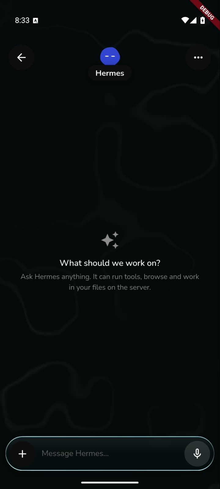
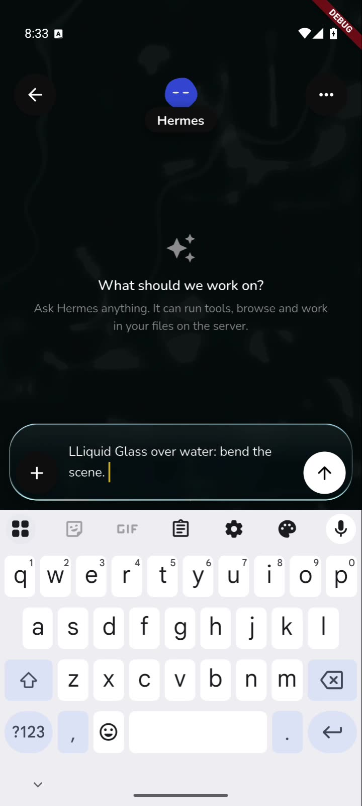
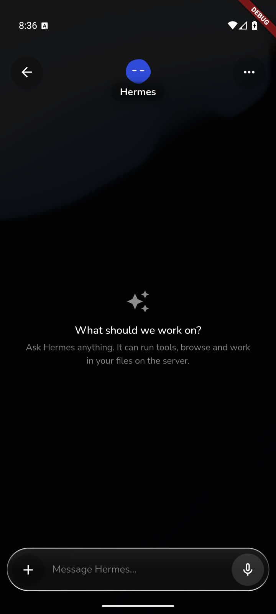
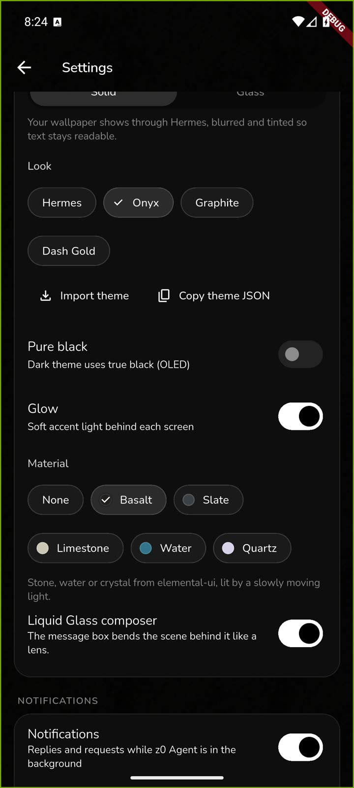

# HA-029: Liquid Glass and elemental-ui surfaces

Settings → Look & Feel now has a **Material** row and a **Liquid Glass
composer** switch, next to the Solid / Glass surface from PRs #25 and #28.

- **Material** paints a thin, lit pane of an
  [elemental-ui](https://github.com/kvnloo/elemental-ui) material behind every
  NextGen screen: vesicular basalt, layered slate or porous limestone (the
  elemental-ui texture packs), or procedural water and quartz. A light drifts
  slowly over it, and water moves. Reduce motion freezes it. It works on Solid
  and on Glass (over the wallpaper).
- **Liquid Glass composer** turns the message box into a refracting lens
  (`liquid_glass_renderer`) with a lit rim and a thicker slab of the same
  material. On renderers without Impeller it falls back to frosted glass.
- Text stays readable: each theme gets the largest material dose (body
  opacity, then glare) that keeps every text role that meets WCAG AA on the
  plain background at AA over the worst-case material colours. Dark themes
  keep the stone and lose glare; light themes keep the light and thin dark
  stone. `test/ng_elemental_test.dart` checks every look × brightness ×
  material.

## Recordings

All three were recorded on an **API 36 x86_64 emulator** (software GPU,
Impeller on OpenGLES), against the synthetic `tools/fake_gateway` fixture.
The emulator draws at a few frames per second, so motion is choppy. A
Galaxy S25 recording is still to come (see the PR's device checklist).

| Clip | What it shows |
| --- | --- |
| [ha029-1-materials-settings.mp4](ha-029/ha029-1-materials-settings.mp4) | Look & Feel (Dark, Onyx, Solid): None → Slate → Limestone → Water → Quartz → Basalt, then Liquid Glass on. 1080×2400. |
| [ha029-2-liquid-glass-water-chat.mp4](ha-029/ha029-2-liquid-glass-water-chat.mp4) | A chat over Water (moving caustics) with the Liquid Glass composer: typing, sending, the fixture's reply. 720×1600. |
| [ha029-3-glass-quartz-chat.mp4](ha-029/ha029-3-glass-quartz-chat.mp4) | Glass surface (wallpaper through the window) with Quartz and the Liquid Glass composer: a message and its reply, then home. 720×1600. |

## Stills

| Water chat | Water chat, replied | Glass + Quartz | Material settings |
| --- | --- | --- | --- |
|  |  |  |  |

`ha-029/basalt-liquid-golden-preview.jpg` is a widget-test render (Skia, so
the composer uses the frosted fallback) of Basalt behind a chat.

The fixture's canned reply is a Romanian test string ("Răspuns Desktop
Gateway primit corect."); it is fixture data, not app copy.

## Licensing

The stone packs and the lighting model are elemental-ui's, GPL-3.0-only
(© Kevin Rajan); see `third_party/NOTICE.md` and
`third_party/elemental-ui/PROVENANCE.md`. `liquid_glass_renderer` is MIT.
